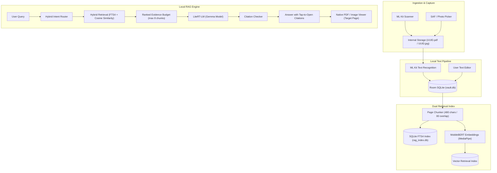

# Vault

> **Personal Document Intelligence. 100% On-Device. Zero Cloud Leaks.**

Vault is an Android local-first document management and intelligence system built for high-speed document capture, organization, on-device OCR, and private retrieval-augmented generation (RAG). 

Operating with **zero internet permissions**, Vault processes, embeds, indexes, and answers questions from your sensitive personal documents (such as government IDs, contracts, receipts, and medical files) directly on your device hardware without third-party servers, cloud inference, or recurring API subscription fees.

---

## Key Features

### 📸 Intelligent Document Ingestion
- **ML Kit Document Scanner**: Native camera scanning powered by Google Play Services ML Kit with real-time corner detection, perspective correction, shadow removal, and contrast enhancement.
- **Universal Import**: Seamlessly import PDFs and high-resolution images (`JPEG`, `PNG`) using Android's Storage Access Framework and Photo Picker.
- **Two-Step Atomic Writes**: Physical files are committed to app-private internal storage under unique UUIDs before SQLite metadata rows are inserted, eliminating orphaned database records.

### 🗂️ Clean Document Organization
- **Structured Hierarchy**: Organize documents into user-defined folders pre-seeded with a default Inbox.
- **Safe Modifications**: In-place document renaming, folder reassignments, and cascade deletions that safely clean up both Room records and physical storage.
- **Storage Metrics**: Real-time visual metrics detailing document counts, storage utilization, and categorized file formats.

### 🔍 Native Hardware Viewers
- **Zero-Dependency PDF Rendering**: Renders multi-page PDFs using the native Android framework `PdfRenderer` off the main thread with page bitmap recycling to minimize memory footprint.
- **Touch-Optimized Image Viewer**: High-performance image viewer supporting multi-touch gestures, pinch-to-zoom, and smooth panning.

### 📝 On-Device OCR & Text Editing
- **Bundled Text Recognition**: Offline Optical Character Recognition powered by Google ML Kit Text Recognition (`com.google.mlkit:text-recognition`) for Latin script.
- **Multi-Page Extraction**: Sequentially extracts text page-by-page from scanned documents and multi-page PDFs.
- **Authoritative Text Editor**: Independent text view where users can review, correct, or delete OCR text without modifying the original binary document.
- **Monotonic Revision Tracking**: Updates to text increment document-wide revision counters to ensure search and AI indices never serve stale evidence.

### 🧠 Private On-Device AI & Local RAG
- **Hybrid Intent Routing**: Dynamically classifies user queries into semantic document listings or factual lookups using deterministic keyword patterns and local AI classification.
- **On-Device Vector Embeddings**: Employs MobileBERT (`mobile_bert.tflite`) via Google MediaPipe Tasks Text to produce dense semantic representations of document chunks.
- **High-Speed Dual Retrieval**: Combines cosine similarity vector search with SQLite FTS4 full-text search to retrieve the most relevant page excerpts within milliseconds.
- **Local Language Model Generation**: Runs the Gemma language model entirely on phone hardware using Google LiteRT-LM (`litertlm-android`), requiring no network connectivity.
- **Verifiable Citations**: Every AI response includes verifiable source tags (`[S1]`, `[S2]`) that let users tap directly into the exact document and cited page.

### 🛡️ Air-Gapped Privacy & Security
- **No Internet Access**: The `android.permission.INTERNET` permission is completely omitted from `AndroidManifest.xml`.
- **Backup Exclusion**: `android:allowBackup="false"` prevents cloud scraping and automated cloud backups.
- **App-Private Storage**: All documents and databases are stored in sandboxed internal directories (`context.filesDir/documents/`).

---

## Architecture & Data Flow



---

## Technology Stack & Libraries

| Category | Technology | Version | Purpose |
| :--- | :--- | :--- | :--- |
| **Language** | Kotlin | `2.2.10` | Core application logic and type-safe development |
| **UI Framework** | Jetpack Compose | BOM `2026.02.01` | Modern declarative UI design |
| **Design System** | Material 3 | Compose BOM | Android Material Design components & typography |
| **Navigation** | Navigation Compose | `2.8.5` | Type-safe in-app screen routing |
| **Architecture** | AndroidX Lifecycle & ViewModel | `2.9.4` | MVVM pattern, coroutine scopes, and StateFlow |
| **Local Database** | AndroidX Room | `2.6.1` | SQLite database with KSP code generation & FTS4 |
| **Annotation Processing** | KSP (Kotlin Symbol Processing) | `2.2.10-2.0.2` | Fast compile-time code generation for Room |
| **Document Scanner** | Google Play Services ML Kit | `16.0.0` | Camera capture, edge detection, perspective warp |
| **Text Recognition** | Google ML Kit Text Recognition | `16.0.1` | Local Latin script OCR for images and PDFs |
| **Vector Embeddings** | Google MediaPipe Tasks Text | `1.0.0` | On-device text embeddings via `mobile_bert.tflite` |
| **On-Device LLM** | Google LiteRT-LM | `0.15.0` | Offline Gemma language model execution (`litertlm-android`) |
| **Document Rendering** | Android Framework `PdfRenderer` | Platform (API 21+) | Native zero-dependency PDF page rendering |
| **Concurrency** | Kotlin Coroutines & Flow | `1.9.0` | Asynchronous background dispatching (`Dispatchers.IO`) |
| **Build System** | Android Gradle Plugin (AGP) / Gradle | AGP `9.4.1` / Gradle `9.6.0` | Build orchestration and dependency resolution |
| **SDK Levels** | Compile: `37` / Target: `37` / Min: `26` | Android 8.0+ | Modern Android standards and hardware optimization |

---

## Project Structure

```
appbuilder/
├── app/
│   ├── src/
│   │   ├── main/
│   │   │   ├── AndroidManifest.xml          # Zero network permission manifest
│   │   │   └── java/com/example/vault/
│   │   │       ├── data/
│   │   │       │   ├── local/               # Room entities (Folder, Document, Page), DAO, Database
│   │   │       │   └── repository/          # VaultRepository & FileStorageManager (Atomic writes)
│   │   │       ├── ocr/                     # TextRecognitionHelper (ML Kit OCR engine)
│   │   │       ├── rag/
│   │   │       │   ├── generation/          # AnswerGenerator, EvidencePrompt, CitationChecker
│   │   │       │   ├── index/               # PageChunker, SqliteRetrievalIndex (FTS4), VectorMath
│   │   │       │   ├── model/               # RAG data models, search scopes, citation contracts
│   │   │       │   ├── source/              # RoomDocumentSource (Database to RAG bridge)
│   │   │       │   ├── IntentRouter.kt      # Hybrid intent classification (List vs Fact lookup)
│   │   │       │   ├── RagConfig.kt         # Context, token, and similarity thresholds
│   │   │       │   └── RagPipeline.kt       # End-to-end question-answering coordinator
│   │   │       ├── scanner/                 # DocumentScannerHelper (ML Kit GmsDocumentScanner)
│   │   │       └── ui/
│   │   │           ├── chat/                # ChatScreen, ChatViewModel, RightChatDrawer
│   │   │           ├── editor/              # SaveDocumentScreen, DocumentTextScreen
│   │   │           ├── main/                # MainScreen shell
│   │   │           ├── navigation/          # NavRoutes & AppNavigation (NavHost)
│   │   │           ├── settings/            # SettingsScreen & storage preferences
│   │   │           ├── theme/               # Color, Theme, Typography definitions
│   │   │           ├── vault/               # VaultScreen (Folders, storage stats), FolderDetailScreen
│   │   │           └── viewer/              # PdfViewerScreen, ImageViewerScreen, CropOverlay
│   │   └── test/                            # Unit test suite
│   └── build.gradle.kts                     # App module build configuration
├── gradle/
│   └── libs.versions.toml                   # Centralized dependency catalog
├── docs/                                    # Architectural specifications and integration plans
├── build.gradle.kts                         # Root build configuration
└── settings.gradle.kts                      # Gradle settings & plugin management
```

---

## Getting Started

### Prerequisites
- **Android Studio**: Ladybug (2024.2.1) or newer recommended.
- **Java Development Kit**: JDK 17 or JDK 21.
- **Android SDK**: Android API Level 37 SDK platform and build-tools installed.
- **Physical Device / Emulator**: Running Android 11 (API level 30) or higher.

### Building from Source

Clone the repository and build the debug APK using the Gradle wrapper:

```bash
# Clone the repository
git clone <repository-url>
cd appbuilder

# Build debug APK
./gradlew assembleDebug

# On Windows PowerShell
.\gradlew.bat assembleDebug
```

### Running Unit Tests

Execute the automated test suite across Room entities, chunking logic, and repository contracts:

```bash
./gradlew testDebugUnitTest

# On Windows PowerShell
.\gradlew.bat testDebugUnitTest
```

### Deploying to Device

Connect your Android device via USB with Developer Options and USB Debugging enabled, then execute:

```bash
./gradlew installDebug

# On Windows PowerShell
.\gradlew.bat installDebug
```

---

## On-Device AI Models

Vault relies on locally provisioned model weights to perform embedding and text generation:

1. **Text Embedding Model**: `mobile_bert.tflite` placed in `app/src/main/assets/` to compute local semantic vectors for document chunks.
2. **Generative LLM**: `chat.litertlm` (quantized Gemma model formatted for Google LiteRT) loaded into device storage for on-device inference without cloud dependencies.

---

## Data Privacy Guarantee

Vault is architected around the core principle of digital sovereignty:

- **100% Offline**: No network sockets, HTTP clients, or telemetry tracking SDKs are included.
- **Zero Cloud Backups**: Device-to-cloud automated synchronization is explicitly disabled.
- **Local Isolation**: Document binaries and index databases never leave sandboxed internal storage.
- **Non-Destructive OCR**: Original scanned files remain unchanged even if extracted text is edited or cleared.

---

## License

This project is licensed under the MIT License - see the LICENSE file for details.
