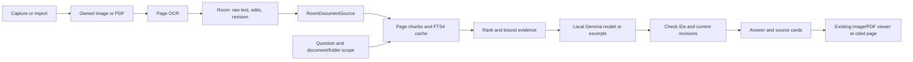

# Vault: Milestones 1-5 integration plan

Status: approved and implemented on `merged`. The combined-app guide records implementation details and check results.

## Agreed scope

Combine the `ui` and `rag` implementations into one application on a new integration branch.
Use real saved documents and authoritative page text from Milestones 1-4 as evidence for Milestone 5.

The user selected keyword retrieval for the fastest MVP. This plan therefore keeps SQLite FTS4.
Neither branch currently produces semantic embeddings. The integration builds a searchable text index, without an embedding model or vector database.
The existing Gemma model generates answers from retrieved text. It does not supply retrieval embeddings.

## References and repository findings

References:

- [UI implementation reference](<C:/Users/ron/Downloads/implementationm plan.pdf>)
- [RAG architecture reference](<C:/Users/ron/Downloads/plans/Vault_RAG_Architecture.pdf>)
- The project reference pasted in this chat.

The PDFs describe the intended architecture. The inspected branch code determines the current integration points.
Document instructions do not authorize commands, installations, or implementation before plan approval.

| Area | Current implementation | Integration consequence |
| --- | --- | --- |
| `ui` branch | `526a6f7`, based on scaffold `6772bad` | Use it as the application and navigation base. |
| `rag` branch | `6de7815`, based on the same scaffold | Merge its retrieval, generation, chat, and checks. |
| Original documents | App-private files with stable UUID filenames | Preserve these files and their existing metadata IDs. |
| Authoritative database | Room `vault.db`, version 1 | Keep this database name. The older UI PDF names `docvault.db`. |
| OCR output | `DocumentPageEntity.rawText`, one row per page | Reuse the current bundled ML Kit extraction flow. |
| Edited output | `editedText`, with `content = editedText ?: rawText` | Index `content`, including an intentionally empty edited value. |
| Text version | Page `updatedAt` timestamps | Add a monotonic text revision. Timestamps alone do not establish revision identity. |
| Page publication | Delete and insert occur separately | Make replacement transactional before connecting retrieval. |
| RAG input | `AssetDocumentSource` by default | Explicitly select a Room-backed source in the combined app. |
| Retrieval cache | Private SQLite FTS4 `rag_index.db` | Retain it as a disposable cache to minimize changes. |
| PDF navigation | Document ID only, initial page 1 | Add an optional cited page to the route and viewer. |
| Folder deletion helper | Cascades database rows without deleting the owned files | Correct file cleanup if this existing helper is used. |
| Dependencies | Both use Kotlin 2.2.10 and the same build tools | Combine their dependencies without build-tool upgrades. |
| Local files | IDE change, demo assets, model, and build log | Preserve these files during future branch work. |

The RAG PDF contains broader claims about security, latency, and fallback than the code establishes.
This plan retains citation-ID checks without treating them as proof of answer correctness or prompt-injection immunity.

## Branch and merge strategy

After approval:

1. Recheck branch commits and local changes.
2. Preserve the current checkout and all local files.
3. Create an isolated checkout of `merged` from `ui`, as requested by the user.
4. Merge `rag` into that integration branch.
5. Resolve shared files by retaining both features.
6. Complete the integration and checks on the new branch.

The original `ui` and `rag` branches remain available. The integration branch contains both histories.
The working directory currently uses `ui`, so an isolated checkout protects the existing IDE change and untracked model.

| Shared area | Merge decision |
| --- | --- |
| `MainActivity.kt` | Retain the UI branch's `AppNavigation` entry. Add chat inside its graph. |
| `app/build.gradle.kts` | Retain Room/KSP, scanner, OCR, Navigation, and RAG dependencies. |
| `gradle/libs.versions.toml` | Keep one alias per library. Align required lifecycle components to the RAG-tested 2.9.4 version. |
| Root Gradle configuration | Retain the UI branch's KSP plugin and existing build-tool versions. |
| Manifest | Retain scanner setup metadata, backup exclusions, and no application network permission. |
| Backup XML | Retain RAG exclusions for documents, databases, and models. |
| `.gitignore` | Retain IDE and model exclusions. Replace the broad assets exclusion with rules that permit test fixtures. |

## Data extraction and authoritative storage

The existing scanner or picker supplies an image or PDF URI.
`FileStorageManager` copies the original into app-private storage before the repository saves document metadata.
The document keeps its stable Room ID, folder ID, MIME type, and relative file path.

If extraction on save is enabled, the current OCR helper processes the owned file.
Images produce page 1. PDFs render one page at a time and pass each rendered page to bundled ML Kit Latin recognition.
PDF page index 0 maps to citation page 1. Page boundaries remain intact throughout extraction and retrieval.

The first integration does not add a PDF text-layer parser. It reuses the branch's existing OCR path for both scanned and digital PDFs.

OCR results first exist in memory. The repository publishes the completed page set in one Room transaction.
Raw OCR stays separate from edited text. Existing edited values remain authoritative after a repeated extraction of the same page.

If extraction fails or is cancelled, existing text remains intact.
A missing source file or recognition error must not appear as a successful empty replacement.
A successfully processed blank page can contain empty text and contribute no chunks.

The document save and OCR result remain separate outcomes.
If OCR fails after a successful save, the UI reports the extraction error and retains the document for browsing and retry.
Deletion checks also cover the current folder helper, whose database cascade leaves owned files behind.
The integration corrects that cleanup path without adding a new folder-management feature.

## Text revisions and database migration

Add a positive `textRevision` counter to `DocumentEntity`, with a database default of 1.
Use a document-wide counter for this MVP. Each page maps to the current document revision.
This conservatively invalidates all page chunks after any text change and survives deletion of page rows.

Increment the counter in the same transaction as:

- Successful OCR publication or replacement.
- A saved page-text edit.
- Deletion of extracted text.

Renaming a document or folder changes retrieval metadata but does not increment the text revision.

An OCR job captures the current document revision before extraction.
Before publication, the transaction checks that the document still exists and its revision still matches.
If the user edited or deleted text during extraction, discard the older OCR result instead of restoring outdated content.

Upgrade Room from version 1 to version 2 with an explicit migration.
Preserve folder records, document records, page text, IDs, and relative paths.
Register the migration and disable destructive fallback for the production vault.
Add schema records and a migration check that starts with an existing version-1 vault.

## Connect Room to RAG

Add `RoomDocumentSource` as the production implementation of `DocumentSource`.
The repository supplies a consistent snapshot of documents, folders, and pages from one Room transaction.
Do not assemble the snapshot from independently collected flows, which can represent different database states.

| UI/Room value | RAG value | Mapping rule |
| --- | --- | --- |
| `DocumentEntity.id` | `RagDocument.id` | Convert the existing Long ID to a string. Never generate a second ID. |
| `DocumentEntity.title` | `RagDocument.title` | Use the current display title. |
| `folderId` and folder name | `folderId`, `folderName` | Preserve the relationship and current name. |
| `DocumentPageEntity.pageNumber` | `TextPage.number` | Keep the existing one-based page number. |
| `DocumentPageEntity.content` | `TextPage.text` | Use edited text when non-null, even when empty. |
| `DocumentEntity.textRevision` | `TextPage.revision` | Use the persisted positive document counter. |
| `editedText != null` | `TextPage.isEdited` | Mark evidence based on user-edited text. |

Sort documents by stable ID and pages by page number for predictable snapshot comparison.
Include documents without extracted text, with an empty page list or empty page content.
They remain visible in the vault but contribute no retrieval evidence.

Configure `RagDependencies` once in the application navigation composition, with the real source and a vault label.
An empty vault must produce an empty-corpus result. It must never silently switch to sample documents.

## Index publication and synchronization

`PageChunker` splits authoritative page text into chunks of up to 700 characters, with up to 100 characters of overlap.
Each chunk retains the document ID, folder ID, title, page number, revision, text offsets, and edited flag.
Chunks never span pages. Offsets describe extracted or edited text, not an exact image region.

`SqliteRetrievalIndex` stores these chunks and their FTS4 entries in `rag_index.db`.
Publish a replacement snapshot in one SQLite transaction. Publish the in-memory snapshot only after that transaction succeeds.

The cache is derived data. `vault.db` remains authoritative.
Keep the two databases separate for this integration instead of introducing a second Room retrieval implementation.

Add a small `RagSyncCoordinator` that observes Room changes to documents, folders, and pages.
It schedules a cache refresh after committed changes, including text or document deletion.
Storage operations remain usable if retrieval is unavailable.

Every question still reads a fresh authoritative snapshot before search. This is the correctness check even if a scheduled refresh fails.
After process restart, refresh from Room before the first search.
If synchronization fails, stop retrieval and report an error instead of answering from an older cache.

Room updates and cache updates are separate transactions, so this plan does not claim atomic publication across both databases.
The refresh and query checks prevent an outdated cache from becoming answer evidence.
Before publishing a model answer, recheck referenced document IDs and text revisions.
If a referenced document or revision changed during generation, discard that result and request another question.

## Question, answer, and reference flow

The question enters the existing query tokenizer. It extracts sanitized terms and excludes conversational stop words.
FTS4 searches chunk text and document titles within the selected document or folder.
Keep the current ranking and retrieve up to four chunks, with a total evidence budget of 2,800 characters.
All limits remain in `RagConfig.kt`.

Assign evidence IDs such as `S1` and `S2` before generation.
The local model receives only the bounded evidence and the question, through the existing LiteRT-LM 0.15.0 callback adapter.
Keep CPU inference, disabled thinking, and the existing locally provisioned model.
Keep model weights outside Git and outside the APK.

Check generated citation IDs against the supplied evidence.
Missing or invalid IDs trigger labeled excerpt answers.
No matching evidence produces an insufficient-evidence result without initializing the model.
Model initialization or inference errors permit retry or explicit excerpt mode.

## Navigation and source behavior

Retain the vault as the start screen. Add a Chat action that opens `ChatRoute` in the existing navigation graph.
Retain the chat's existing document and folder selector.

Resolve clicked references through application-controlled IDs, converting numeric strings with a checked conversion.
Look up the current document metadata to choose its image or PDF viewer.
Add an optional one-based page argument to PDF navigation, with page 1 as the normal browsing default.
Convert to a zero-based `PdfRenderer` index only inside the viewer.

Carry the reference revision and edited-text flag in a typed source-navigation request.
The viewer can then label edited evidence and changes after the answer.
Open the associated page without claiming an exact highlight in the original scan.
Keep PDF rendering outside the main thread, including Next/Previous navigation.

If extracted text was deleted, an old source card can still open the existing original document.
If the document or original file is unavailable, show an unavailable-source result instead of an endless loading state.
Returning from a viewer retains the chat while its navigation entry remains on the back stack.

## Proposed file and folder changes

Kotlin paths below start at `app/src/main/java/com/example/vault/`.

| Area | Planned changes |
| --- | --- |
| `data/local/` | Add document revision, a consistent snapshot projection/query, and Room migration support. |
| `data/repository/VaultRepository.kt` | Publish OCR and edits transactionally. Preserve edited values and expose the RAG snapshot. |
| `ocr/TextRecognitionHelper.kt` | Retain current extraction. Distinguish recognition failure from blank text and preserve cancellation. |
| `rag/source/RoomDocumentSource.kt` | New adapter from repository output to existing RAG contracts. |
| `rag/RagSyncCoordinator.kt` | New observer for committed metadata and text changes. |
| `rag/RagDependencies.kt` | Select the real source and wire one coordinator/pipeline for the app. |
| `rag/RagPipeline.kt` | Retain indexing/generation. Add final source-revision checks before answer publication. |
| `rag/model/` | Retain contracts and add typed source-navigation metadata. |
| `ui/navigation/` | Add chat, source routing, and optional cited PDF page arguments. |
| `ui/chat/` | Connect viewer requests and production data. Retain the current functional chat UI. |
| `ui/vault/` | Add the Chat action while retaining capture, import, folders, and explorer actions. |
| `ui/viewer/` | Open the cited page, show reference notices, and keep rendering in background work. |
| `ui/editor/` | Report save/OCR outcomes separately and retain editable authoritative page text. |
| `app/schemas/` | Record Room schema versions for the preserving migration check. |
| `app/src/test/` | Mapping, authoritative-text selection, revisions, and pipeline checks. |
| `app/src/androidTest/` | Migration, real repository-to-RAG flow, viewer page, and model checks. |
| `app/src/androidTest/assets/rag/` | Move or recreate explicit test fixtures. Production does not depend on them. |
| `docs/` | This approval plan and the eventual combined-app handoff guide. |

Existing scanner, file-storage, chunker, keyword index, citation checker, and generator modules remain the starting implementations.
No extra embedding runtime, vector store, cloud service, or background job framework is required.

## Implementation order after approval

| Phase | Work | Result |
| --- | --- | --- |
| 1 | Create integration checkout and merge both branches | One buildable branch retains both sets of features. |
| 2 | Add the preserving migration and transactional text operations | Existing vault data survives and revisions remain reliable. |
| 3 | Add the Room source and cache synchronization | Real saved/edited text replaces dummy evidence. |
| 4 | Connect chat and cited-page navigation | Users move from vault to chat to the original source. |
| 5 | Complete failure handling and combined checks | The capture-to-answer workflow works on the demo phone. |

## Acceptance checks

- Upgrade an existing version-1 vault without losing folders, original files, OCR, or edits.
- Capture/import, save, browse, rename, and open documents through the existing UI.
- Ask about a saved image and a multi-page PDF using their actual extracted text.
- Click a citation for PDF page 3 and open page 3.
- Edit a fact and ask again. The answer uses the edit and a newer revision.
- Save an empty edit. Retrieval must not restore the old raw OCR text.
- Rename a document. New references show its current title and preserve its ID.
- Delete extracted text. Future questions cannot retrieve it, and its original document remains usable.
- Delete a document or folder. Its text disappears from retrieval after synchronization.
- Edit/delete during OCR or generation. An older operation cannot overwrite or publish outdated evidence.
- Ask in a selected document or folder. Other scopes never enter the evidence set.
- Ask with an empty vault, no matching text, a missing file, or an unavailable model. Show the appropriate state.
- Restart the app and ask again from the current authoritative data.
- Run the workflow offline after scanner setup and model provisioning.
- Build, run relevant unit/instrumentation checks, and check local inference on the connected phone.

Tests use isolated databases or uniquely identified test documents. Cleanup targets only test-owned records and files.
Deploy with an update installation that preserves the existing vault and local model. Do not uninstall or reset app data for the merge.

The user approved this plan and requested the branch name `merged`.
